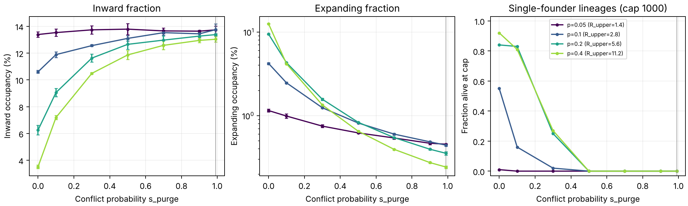
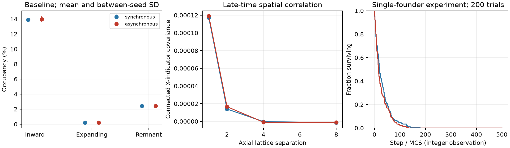
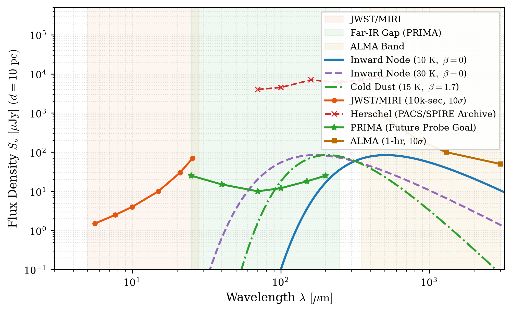

# Thermodynamic Cloaking of Inward Civilizations

[](https://github.com/munder-sa/thermodynamic-cloaking/actions/workflows/tests.yml)
[](LICENSE)
[](https://creativecommons.org/licenses/by/4.0/)

**An illustrative population model and far-infrared/submillimeter forecasts** — S Yamashita, third draft (October 2026).

This repository contains the manuscript, simulation code, figures, and machine-readable results for a *conditional* technosignature model: if a civilization runs localized computation at a specified irreversible erasure rate and rejects the heat at 10–30 K, what would its thermal emission look like, and could current or planned observatories see it?

> The first draft (September 2026) claimed that the Great Silence follows inevitably from thermodynamics, that a 10 K node at 10 pc would be an 83 µJy source at 100 µm, and that COBE/FIRAS excludes large populations. Those claims were wrong or unsupported and have been withdrawn. See [`docs/AUDIT_JA.md`](docs/AUDIT_JA.md) and [`CHANGELOG.md`](CHANGELOG.md).

## Key results (third draft)

Benchmark: 10<sup>40</sup> erased bits/s, Landauer bound saturated, ideal blackbody, 10 pc, no external heating.

| Quantity | 10 K | 15 K | 30 K |
|---|---:|---:|---:|
| Waste power | 9.57×10<sup>17</sup> W | 1.44×10<sup>18</sup> W | 2.87×10<sup>18</sup> W |
| Total emitting area | 1.69×10<sup>21</sup> m² | 5.00×10<sup>20</sup> m² | 6.25×10<sup>19</sup> m² |
| S<sub>ν</sub> peak | ~510 µm | ~340 µm | ~170 µm |
| S<sub>ν</sub> at 100 µm | 0.099 µJy | 3.56 µJy | 54.3 µJy |
| S<sub>ν</sub> at 235 µm | 29.8 µJy | 69.0 µJy | 75.0 µJy |
| S<sub>ν</sub> at 850 µm | 64.7 µJy | 40.6 µJy | 14.0 µJy |
| α (450–850 µm, exact Planck) | 0.380 | 1.007 | 1.553 |

- **Radiators are huge.** At 10 K the total area corresponds to a one-sided disk of 0.155 AU radius. Lowering T reduces power linearly but increases area as T<sup>−3</sup>.
- **Cold sources peak in the submillimeter, not the 30–300 µm “far-infrared gap”.** Exact Planck spectra are required; Rayleigh–Jeans slopes are not.
- **Confusion is the main obstacle.** The 10 K source at 10 pc is about 1500× fainter than the classical PRIMAger 235 µm confusion limit (46 mJy, Donnellan et al. 2024). Single-band blind detection at 10 pc is not supported.
- **A blackbody-like slope does not prove artificiality.** Optically thin 10 K dust with β = 1.7 gives α ≈ 2.08.
- **The Galactic budget is an assumption, not a FIRAS limit.** Under the illustrative budget, the per-node limit is 1.9×10<sup>45</sup> bits/s at 15 K, 5.28 dex above the benchmark.

### Population model

A periodic stochastic cellular automaton (empty / inward / expanding / remnant, 8 neighbors) with chosen, uncalibrated rates. Robustness experiments (October 2026) found:

- **Lattice size:** occupancies are stable from 15×15 to 240×240; for L ≥ 60 the inward fraction stays at 13.88–13.90% (baseline).
- **The ~14% is an input, not an outcome.** Across a one-at-a-time sweep of all eight rates, the inward fraction stays within 92–100% of b/(b+ℓ), i.e. it is set by the assumed emergence and loss rates of inward sites.
- **Expansionist extinction comes from the conflict rule.** Contact with *any* occupied site — including a lineage's own colonies and inert remnants — kills the source with probability 0.99. With that rule no lineage survived, even when the contact-free reproduction bound was 45. With conflict probability ≤ 0.1 and frequent launches, over 80% of lineages survive, and with no conflict expanding sites outnumber inward ones 3.6 to 1.
- **Protecting inward sites from invasion barely matters** under baseline rates: letting conflicts destroy or capture them lowers the inward fraction only from 13.9% to about 12.8%.

<p align="center">
  
</p>

<p align="center">
  
</p>

<p align="center">
  
</p>

## Repository layout

```text
paper/main.tex                 Third draft; standalone (embedded tables and bibliography)
scripts/physics.py             Shared SI blackbody / Landauer model
scripts/run_simulation.py      Seeded synchronous automaton -> fig1, simulation_summary.json
scripts/compare_updates.py     Async comparison, correlations, lineages -> fig4, update_comparison.json
scripts/make_paper_figures.py  Spectra, flux tables, conditional budget -> fig2, fig3
scripts/observational_constraints.py  Confusion, parallax, per-node budget -> fig5
scripts/robustness.py          Lattice size, parameter sweep, conflict, inward vulnerability -> fig6-9
scripts/audit_upstream.py      Reproduces the first-draft update-order bug against an old checkout
tests/                         23 unit and numerical tests
results/                       Machine-readable outputs
figures/                       PDF and PNG figures
docs/                          Audit and revision notes (Japanese)
```

## Reproduce

Python 3.10+.

```bash
git clone https://github.com/munder-sa/thermodynamic-cloaking.git
cd thermodynamic-cloaking
pip install -r requirements.txt

make test      # 23 tests, a few seconds
make figures   # fast outputs: fig2, fig3, fig5 and numerical tables
make all       # also reruns the long simulations and robustness runs (fig1, fig4, fig6-9); over an hour on 2 cores
make paper     # builds paper/main.pdf (needs latexmk)
```

All simulations use fixed seeds, so `make all` reproduces the committed `results/` (differences, if any, are in the last floating-point digit).

## Citation

See [`CITATION.cff`](CITATION.cff), or:

```bibtex
@misc{Yamashita2026,
  author = {Yamashita, S.},
  title  = {Thermodynamic Cloaking of Inward Civilizations: An Illustrative Population Model and Far-Infrared/Submillimeter Forecasts},
  year   = {2026},
  note   = {Third draft},
  url    = {https://github.com/munder-sa/thermodynamic-cloaking}
}
```

## Contact

S Yamashita ([@munder-sa](https://github.com/munder-sa)) · munder.sa@gmail.com

Issues and pull requests are welcome, especially on lineage-aware conflict rules, physical propagation delays, and injection–recovery tests in realistic far-infrared maps.
